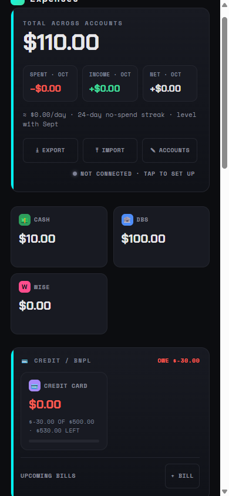

# Expenses

A phone-first expense tracker you own. The app is a static page on GitHub Pages; your ledger is a
single JSON file in a private GitHub repo that only you can read. No server, no account, no fees.

- **Log on the spot or days later.** Expense, income, transfer; one-tap date strip; tags.
- **Balances work themselves out.** Enter what each account has once; every entry updates it.
- **Monthly view.** Spend calendar, category bars with budgets, upcoming bills, who owes you.
- **Syncs across your devices** through your private vault, offline-first.
- **Your Claude can manage it.** The vault ships with a `CLAUDE.md`, so Claude Code can add, fix
  and summarise entries when you ask.
- **Optional Back Tap capture** on iPhone: screenshot a receipt, confirm, done.

## Get started

Follow [`docs/SETUP.md`](docs/SETUP.md). About 15 minutes, two clicks on GitHub and one token.

## Docs

- [`docs/SETUP.md`](docs/SETUP.md): the walkthrough.
- [`docs/DATA-FORMAT.md`](docs/DATA-FORMAT.md): the ledger JSON and the sync rules.
- [`docs/CAPTURE-SHORTCUT.md`](docs/CAPTURE-SHORTCUT.md): the iPhone Shortcut.

## Development

No build step. Serve the folder (`python -m http.server`) and open it. Pure logic lives in
`scripts/*.js` with tests: `node --test scripts/*.test.js`. Any change to a cached asset
(scripts, fonts, icons, manifest) needs a `VERSION` bump in `sw.js`.

Lifted from the Expenses tab of KC's StudyTracker.
